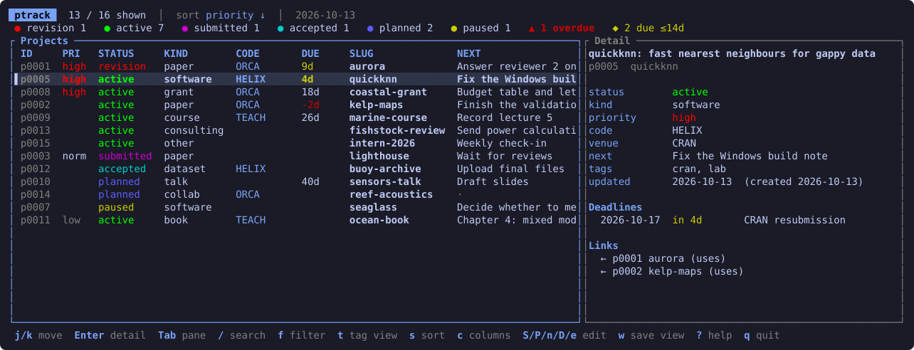

# ptrack

A terminal tracker for everything you have in flight: papers, software,
grants, courses, talks, books, datasets, consulting jobs. Each project gets
one permanent id (`p0042`) and a readable slug (`aurora`); either works
wherever a project is expected.

The registry is plain TOML, one file per project, so it diffs well and can
live in git next to your work.

## Install

    cargo install --git https://github.com/ielbadisy/ptrack

or, from a clone, `cargo install --path .`

## Try it on the demo registry

All projects, people and venues in the demo are invented.

    ./examples/make-demo.sh
    PTRACK_REGISTRY=examples/demo/.registry \
    PTRACK_BROWSE_CONFIG=examples/browse.toml ptrack

## Your own registry

    ptrack init ~/projects
    cd ~/projects/papers/aurora
    ptrack new paper "Aurora: tidal forecasting" --slug aurora --priority high --code ORCA --here

`--here` writes a `.ptrack-id` file into the folder, so inside it the project
argument can be omitted (`ptrack show`) or given as `.`.

The registry is found through `$PTRACK_REGISTRY`, then a `.registry/` found
walking up from the current directory, then `~/projects/.registry`.

## Dashboard

Run `ptrack` (or `ptrack browse`). The list sits on the left and the selected
project's details on the right: deadlines with countdowns, submission
history, links in both directions, notes.

| Keys | |
|---|---|
| `j`/`k`, arrows, mouse wheel | move (scrolls the detail pane when it has focus) |
| `PgUp`/`PgDn`, `Ctrl-u`/`Ctrl-d`, `g`/`G` | page, half page, first, last |
| `Enter` / `Tab` / `v` / `<` `>` | full-screen detail / focus pane / pane on-off / resize |
| `/` | live search over id, code, slug, title, next action, venue, tags, notes |
| `f` / `F` | filter by status, kind, priority, tag or code / clear filters |
| `t` | cycle quick tag views (`quick_tags` in the config) |
| `a` | also show published, archived and hidden projects |
| `s` / `r` | cycle sort (priority, deadline, status, updated, id, slug, code) / reverse |
| `c` | choose columns (`Space` toggles, `J`/`K` reorder) |
| `S` `P` `K` | set status, priority, kind of the selected project |
| `n` / `D` | edit next action / add a deadline (`2026-11-02 camera-ready`) |
| `e` | set any field: `venue=Stochastic Harbours`, `tags=lab,cran`, `notes=...` |
| `w` | save the current view as your default |
| `R` / `?` / `q` | reload from disk / help / quit |

Edits are written to the registry straight away.

### Config

`~/.config/ptrack/browse.toml` (or `$PTRACK_BROWSE_CONFIG`) sets the default
columns, sort, filters, hidden statuses, quick tags, pane width, the "due
soon" horizon and colors. Press `w` to write it from the current view, or
start from [`examples/browse.toml`](examples/browse.toml).

## Commands

    ptrack init [ROOT]
    ptrack new KIND TITLE [--slug S] [--status S] [--priority P] [--code C] [--venue V]
                          [--next TEXT] [--path DIR | --here] [--repo URL] [--collab NAME]... [--tag T]...
    ptrack ls [--kind K] [--status S] [--priority P] [--venue TEXT] [--tag T] [--code C] [--all]
    ptrack show [ID|SLUG]
    ptrack set ID field=value ...          # an empty value clears it: venue=
    ptrack submit ID VENUE [--date YYYY-MM-DD] [--note TEXT]
    ptrack outcome ID under-review|revision|rejected|accepted|published|withdrawn [--date] [--note]
    ptrack deadline ID 2026-11-02 camera-ready   |   ptrack deadline ID --rm N
    ptrack next [--kind K]
    ptrack due [--within 30d|2w|3m]
    cd "$(ptrack path ID)"
    ptrack link ID uses OTHER              |   ptrack link ID --rm N
    ptrack scan [--fix] [--depth 5]
    ptrack check [-q]
    ptrack export [--kind K] [--tag T] [--all] [--within 60d] [--out FILE | --json]

Kinds: paper software book course grant consulting website dataset collab talk other.

Statuses: idea planned active paused submitted revision accepted published
archived. `published` and `archived` are hidden from `ls` and the dashboard
unless asked for.

- `code` is a short portfolio or programme code (`ORCA`, `HELIX`); several
  projects can share one, and the dashboard can filter and sort by it.
- `outcome` updates the latest submission and the project status; `rejected`
  and `withdrawn` put the project back to `active`.
- `link` stores the target's id, so links survive slug changes.
- `scan` compares registry folders with the `.ptrack-id` files on disk and
  reports moved, missing and untracked folders. `--fix` records moved folders
  and writes missing id files; it never deletes anything.
- `check` compares the DESCRIPTION of each R package project with CRAN's
  PACKAGES index (fetched with curl, or `$PTRACK_CRAN_PACKAGES` for a local copy).
- `export` writes a markdown overview (deadlines, then one table per kind).
  With `--out` it only overwrites files it generated itself.

## License

MIT
